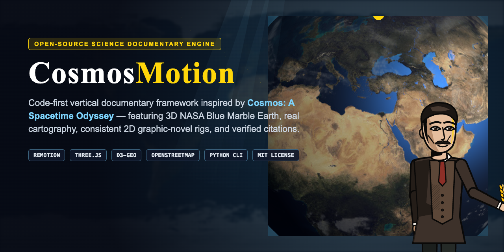
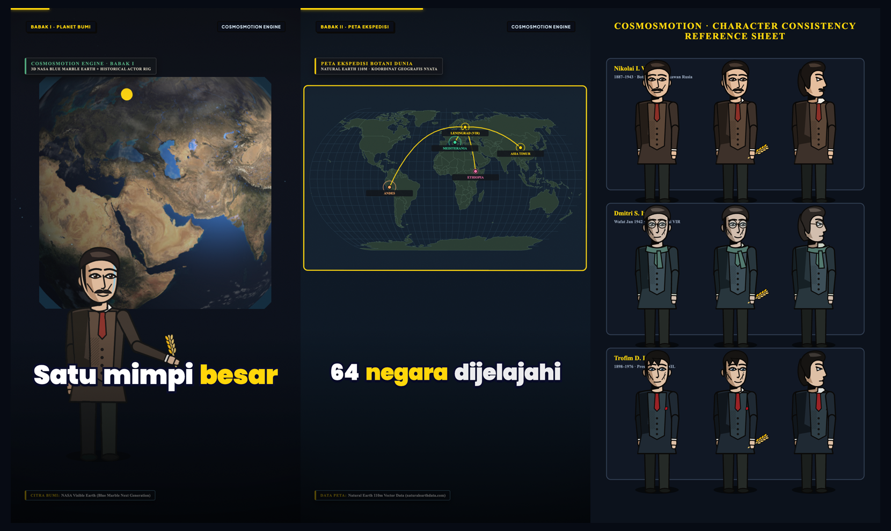
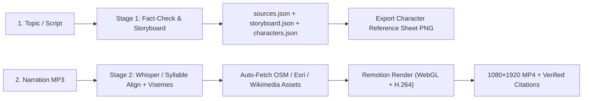

<div align="center">



<br /><br />

# CosmosMotion

**Open-Source Science Documentary Video Engine inspired by *Cosmos: A Spacetime Odyssey***

[](./LICENSE)
[](https://www.remotion.dev/)
[](https://threejs.org/)
[](https://d3js.org/)
[](https://www.openstreetmap.org/)
[](./cli/cosmos.py)

*Code-first vertical (`1080×1920`) documentary framework combining **3D NASA Blue Marble Earth**, **real cartography**, **consistent 2D graphic-novel historical characters**, **Treemation-style karaoke subtitles**, and **verifiable per-scene source attributions**.*

[Quick Start](#-quick-start) • [Visual Showcase](#-visual-showcase) • [Architecture](#-architecture) • [CLI Reference](#-python-cli-reference) • [AI Agent Skill](#-ai-agent-skill-integration) • [License](#-license--third-party-attributions)

</div>

---

## ✨ Why CosmosMotion?

Most AI-generated history/science videos suffer from **"AI slop"**: shifting character faces, hallucinated world maps, flat vector shapes, and zero source citations. **CosmosMotion** solves this by treating documentary filmmaking as reproducible code:

- 🌍 **Real 3D Earth & Space (`@cosmos-motion/geo-space`):** Three.js WebGL globe using **NASA Visible Earth *Blue Marble Next Generation*** textures, cloud layers, atmospheric scattering, and exact `(lat, lon)` pins.
- 🗺️ **Real Geographic Maps (`NaturalEarthMap` & `SlippyTileMap`):** Exact coastlines via `d3-geo` + `world-atlas 110m`, animated geodesic routes, and stitched **OpenStreetMap** / **Esri World Imagery** satellite tiles.
- 🎨 **Consistent 2D Graphic-Novel Characters (`@cosmos-motion/characters`):** JSON-driven `<HistoricalActor />` rig with `Front`, `3/4`, and `Profile` views, audio-reactive viseme lip-sync, secondary motion (breathing, scarf sway, sub-zero breath vapor), and an automatic **Character Reference Sheet** PNG exporter.
- 🎥 **Cinematic Camera & Atmosphere (`@cosmos-motion/core`):** Bezier-eased `CinemaCam` (`dollyIn`, `craneUp`, `pushDiag`, `trackRight`) with handheld micro-sway, `PhotoPlate` archival grading, `LightShafts`, `Dust`, `Boil`, and `FilmLook`.
- 💬 **Treemation-Style Subtitles:** Bold `Poppins 900` word-by-word yellow karaoke bounce subtitles (`<TreemationSubtitle />`).
- 📚 **Mandatory Source Transparency (`cli/verify_sources.py`):** Every scene in `storyboard.json` must link to `sources.json`, automatically rendering per-scene `<SourceBadge />` attributions and an end-of-video `<ReferenceEndCard />`.

---

## 🎬 Visual Showcase

<div align="center">
  
  <br />
  <sub>Left: <strong>3D NASA Blue Marble Earth + Historical Actor Rig</strong> &nbsp;|&nbsp; Center: <strong>Natural Earth 110m Geodesic Expedition Map</strong> &nbsp;|&nbsp; Right: <strong>Multi-View Character Reference Sheet</strong></sub>
</div>

---

## 🏗️ Architecture & 2-Stage Workflow



### Repository Structure

```text
cosmos-motion/
├── cli/                        # Python CLI (init, fetch, align, verify, render)
├── docs/                       # README cover banner & visual showcase
├── packages/
│   ├── core/                   # CinemaCam, TreemationSubtitle, SourceAttribution, DocumentaryLayout
│   ├── characters/             # CharacterSchema, HistoricalActor rig, CharacterReferenceSheet
│   ├── geo-space/              # RealEarth3D (NASA Blue Marble), NaturalEarthMap, SlippyTileMap
│   └── scenes/                 # SplitConfrontation, ArchivalDossier, MacroApparatusECU, DataTimelineShot
├── public/assets/earth/        # NASA Blue Marble surface, cloud, & specular textures
├── skills/cosmos-motion/       # Agent Skill (SKILL.md + JSON schema reference)
├── src/                        # Remotion entrypoint, DemoDocumentary & ReadmeCover
└── templates/                  # Starter templates (nikolai-vavilov, michael-faraday)
```

---

## 🚀 Quick Start

### 1. Install via npm / npx (or Clone Repository)
```bash
# Run directly with npx
npx cosmos-motion init my-science-story --title "Marie Curie & Radium"
npx cosmos-motion verify my-science-story

# Or install as a library in your Remotion project
npm install cosmos-motion
```

Or clone the full repository with demo templates:
```bash
git clone https://github.com/EngRidhoNet/cosmos-motion.git
cd cosmos-motion
npm install
```

### 2. Verify TypeScript & Documentary Templates
```bash
npm run typecheck
python3 cli/cosmos.py verify templates/nikolai-vavilov
python3 cli/cosmos.py verify templates/michael-faraday
```

### 3. Preview in Remotion Studio or Render Demo
```bash
# Open interactive Remotion Studio
npm run dev

# Render the Character Reference Sheet PNG
npm run render:charsheet

# Render the 15-second 1080x1920 Demo Documentary MP4
npm run render:demo
```

---

## 🛠️ Python CLI Reference

| Command | Description | Example |
| :--- | :--- | :--- |
| `init` | Scaffold a new documentary project (`project.json`, `storyboard.json`, `characters.json`, `sources.json`) | `python3 cli/cosmos.py init marie-curie --title "Marie Curie"` |
| `verify` | Block rendering if any act in `storyboard.json` lacks a valid citation in `sources.json` | `python3 cli/cosmos.py verify templates/nikolai-vavilov` |
| `fetch` | Download & stitch OpenStreetMap/Esri tiles + Wikimedia Commons archival photos | `python3 cli/cosmos.py fetch my-project` |
| `align` | Generate word-level `TreemationSubtitle` timestamps & `A/E/I/O/U` lip-sync visemes | `python3 cli/cosmos.py align voice.mp3 --script script.txt --out captions.json` |
| `render` | Render any Remotion composition to H.264 MP4 (`--gl=angle`) | `python3 cli/cosmos.py render DemoDocumentary --out out/demo.mp4` |

---

## 🤖 AI Agent Skill Integration

CosmosMotion ships with a ready-to-use **Agent Skill** at [`skills/cosmos-motion/SKILL.md`](./skills/cosmos-motion/SKILL.md) compatible with **Antigravity**, **Claude Code**, and **Cursor**:
1. **Stage 1:** Give the agent a topic → it fact-checks claims, populates `sources.json` & `storyboard.json`, runs `cosmos verify`, and outputs your voiceover script.
2. **Stage 2:** Provide the narration `.mp3` → it runs `cosmos align`, fetches real maps/archival photos, verifies the Character Reference Sheet, and renders the final MP4.

---

## 📄 License & Third-Party Attributions

- **CosmosMotion Source Code:** Released under the [**MIT License**](./LICENSE).
- **Third-Party Data & Runtime Licenses:**
  - **OpenStreetMap:** Map data `© OpenStreetMap contributors` ([ODbL](https://www.openstreetmap.org/copyright)).
  - **NASA Visible Earth & Natural Earth:** Public Domain imagery & vector cartography.
  - **Wikimedia Commons:** Archival photographs retain their respective Public Domain / CC BY-SA attributions recorded in `sources.json`.
  - **Remotion:** Subject to the [Remotion License](https://github.com/remotion-dev/remotion/blob/main/LICENSE.md) (free for individuals, education, and small teams).
